<div align="center">

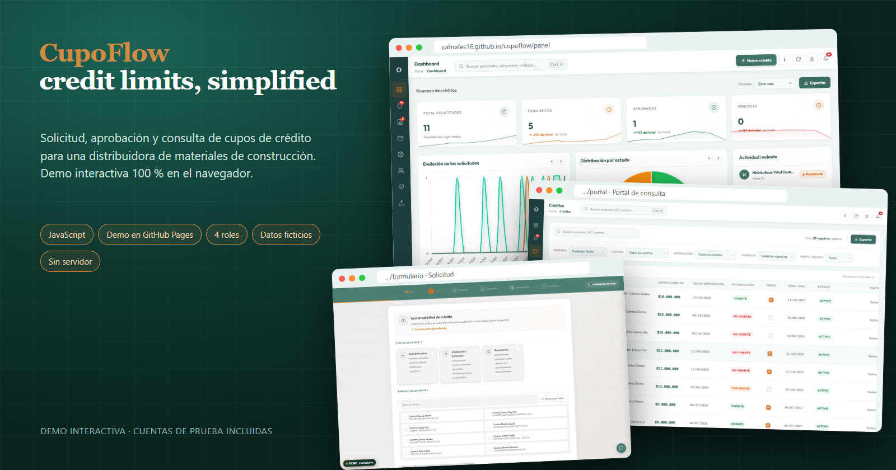

# CupoFlow · credit limits, simplified

Solicitud, aprobación y consulta de **cupos de crédito** para una distribuidora de materiales de construcción.
Cuatro aplicaciones web (índice, formulario, panel y portal) que corren **100 % en el navegador**, con un servidor simulado y datos ficticios.


</div>

> **Proyecto de portafolio.** Todo lo que ves en la demo (empresas, NIT, personas, centros de distribución, correos y montos) es **inventado**.
> El repositorio no contiene credenciales, identificadores de recursos, direcciones de despliegue ni datos reales; el flujo de despliegue ejecuta un escáner de secretos.

---

## Prueba la demo

### [cabrales16.github.io/cupoflow](https://cabrales16.github.io/cupoflow/)

No hay servidor: un *backend simulado* corre en tu navegador y guarda los cambios en `localStorage`.
Cada pantalla tiene una píldora **DEMO** (abajo a la izquierda) con accesos rápidos por rol, la bandeja de correos simulados y el botón **Restablecer datos**.

### Cuentas demo

Contraseña de todas: `Demo2025!`

| Rol | Correo | App | Qué puede hacer |
|---|---|---|---|
| **ADMIN** | `admin@example.com` | Panel + Portal | Todo: aprobar, devolver, rechazar, editar, usuarios, copias de seguridad, auditoría, IA |
| **OPERACIONES** | `operaciones@example.com` | Portal | Consultar créditos, marcar *perfil creado* por centro y comentar |
| **CONSULTAS** | `consultas@example.com` | Portal | Solo lectura (las acciones de escritura son rechazadas) |
| **Ejecutivo comercial** | `comercial1@example.com` | Portal | Vista de solicitudes de sus clientes (rol CONSULTAS) |
| Inactivo | `inactivo@example.com` | — | Para probar el mensaje de cuenta desactivada |
| **Solicitante** | *(cualquier correo)* | Formulario | No requiere cuenta: el código de verificación aparece en pantalla |

### Servicios simulados en la demo

| Servicio | En la demo |
|---|---|
| Correo (códigos, cartas, alertas) | Bandeja simulada dentro de la página; los códigos se muestran en pantalla |
| Almacenamiento de documentos | Solo metadatos; el visor abre un PDF de ejemplo generado en el navegador |
| Base de datos | `localStorage` con datos semilla ficticios |
| IA (análisis de expedientes, chat, extracción) | Respuestas de ejemplo con aviso «simulado» |
| Autenticación y sesiones | Sesiones en `localStorage` con el mismo contrato |
| Exportaciones Excel / PowerPoint | Archivos `.xlsx` y `.csv` reales generados en el navegador |

---

## Funcionalidades

**Formulario de solicitud (público)**
- Asistente de 5 pasos: empresa, representante, facturación, centros y monto, y documentos.
- Verificación de correo por código, carga de PDFs por *chunks*, firma y PDF de la solicitud generado en el cliente.
- Doble firma para filiales, consulta de estado por código y **subsanación** de expedientes devueltos.
- Asistente virtual (preguntas frecuentes) con IA simulada y extracción de datos desde los documentos.

**Panel de control (administración)**
- Dashboard con indicadores, tendencias por periodo y exportación a Excel, CSV y PowerPoint.
- Bandeja de solicitudes con detalle, documentos, **análisis con IA** y acciones: aprobar (con distribución de cupos por centro y carta PDF), devolver, rechazar, editar y eliminar.
- Créditos vigentes por centro, estados calculados (activo, por vencer, vencido, bloqueado), importación masiva desde plantilla.
- Usuarios y roles, auditoría completa, notificaciones, catálogos de centros y **copias de seguridad** con restauración protegida por código.

**Portal de consulta (operaciones y ejecutivos)**
- Consulta de créditos con filtros, semáforo de vigencia de documentos y marca de *perfil creado* por centro.
- Notificaciones de vencimientos, comentarios del ejecutivo y exportación a Excel.
- Permisos por rol (lectura o escritura).

**Índice**: portal de acceso a las tres herramientas.

---

## Galería

Capturas reales tomadas de la demo con un navegador *headless* (`npm run screenshots`).

| | |
|---|---|
| 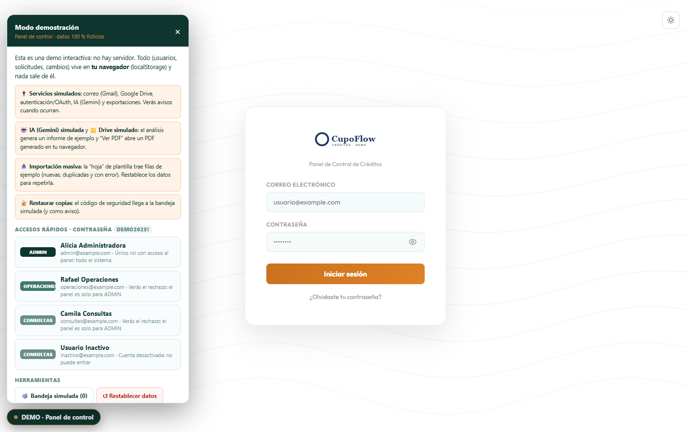<br>**Login y accesos rápidos por rol** | 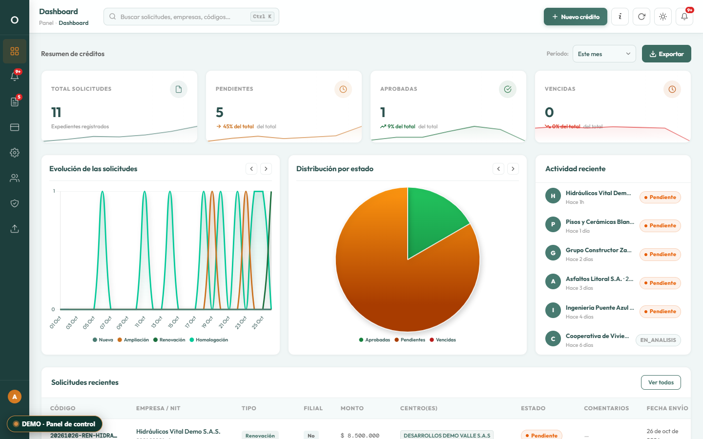<br>**Panel · Dashboard** |
| 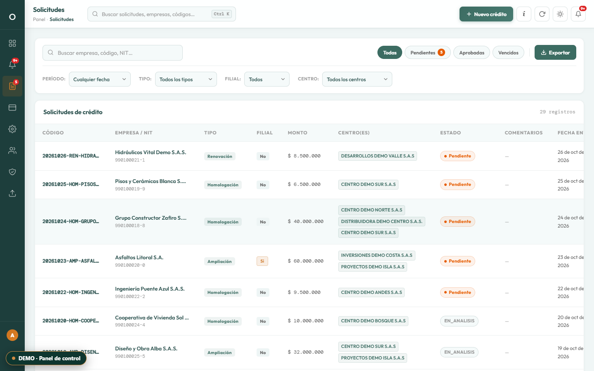<br>**Panel · Solicitudes** | 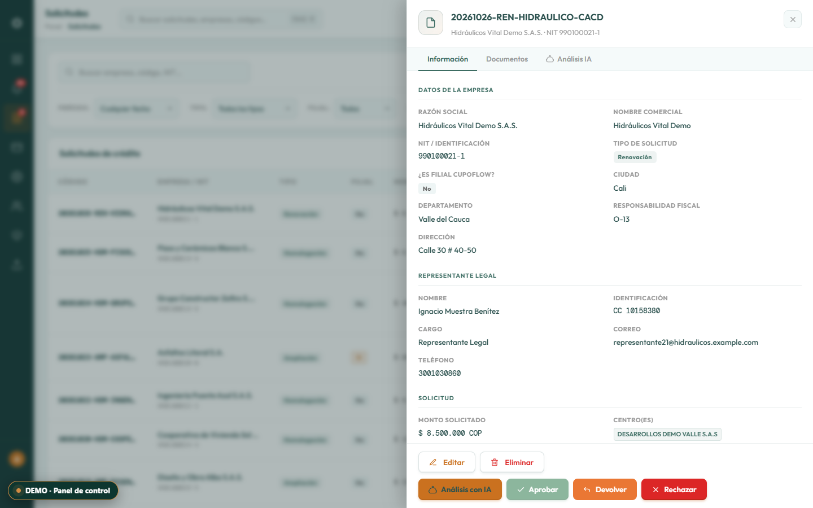<br>**Panel · Detalle y acciones** |
| 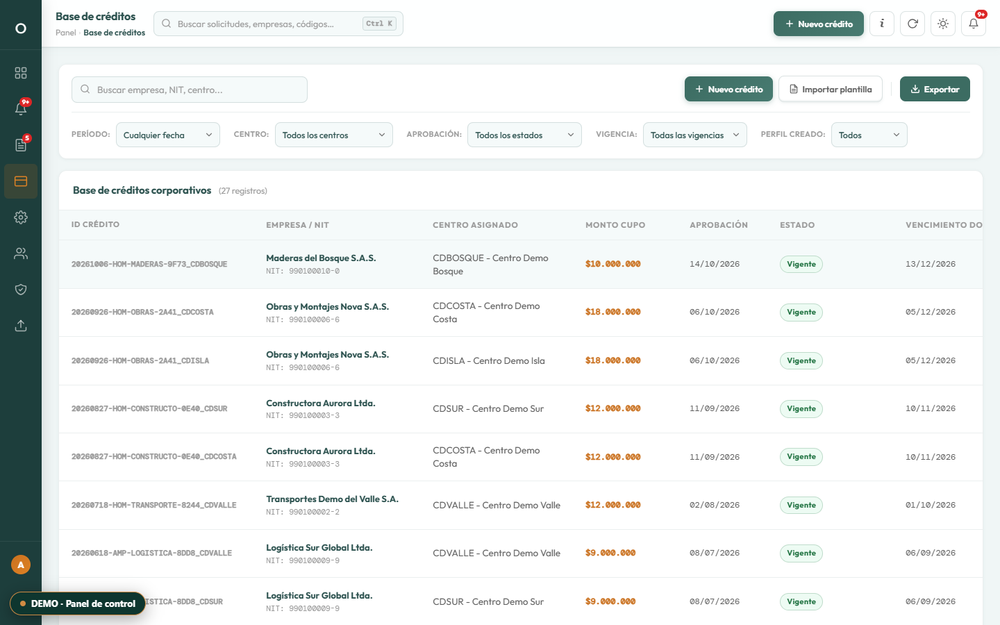<br>**Panel · Créditos** | 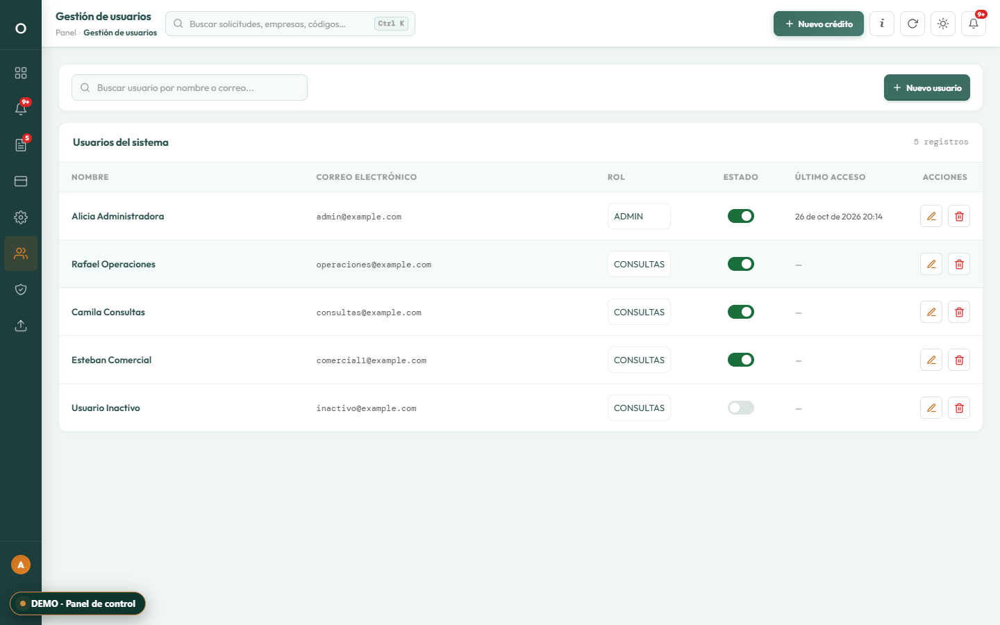<br>**Panel · Usuarios** |
| 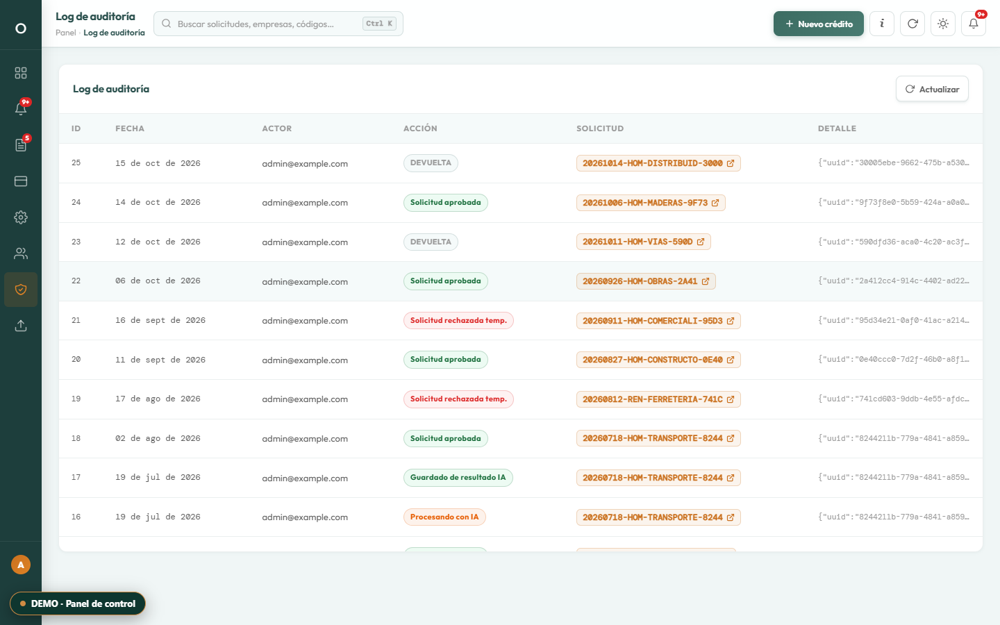<br>**Panel · Auditoría** | 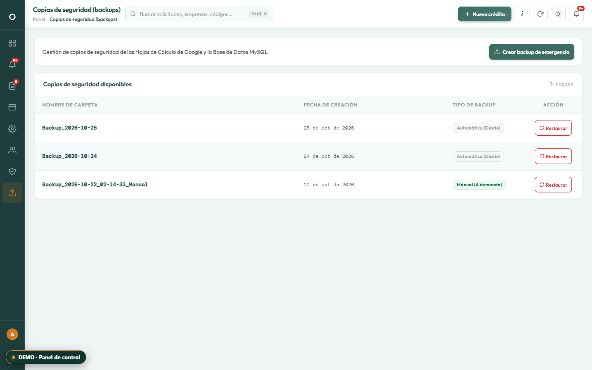<br>**Panel · Copias de seguridad** |
| 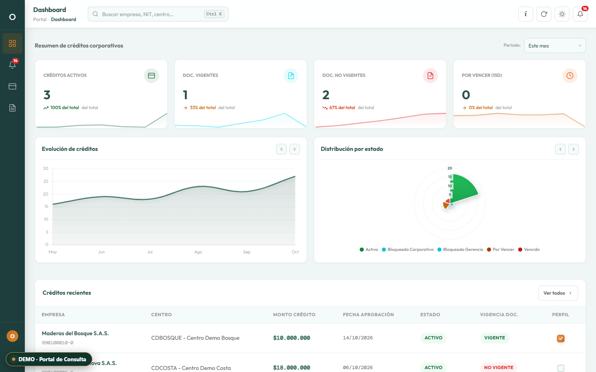<br>**Portal · Dashboard** | 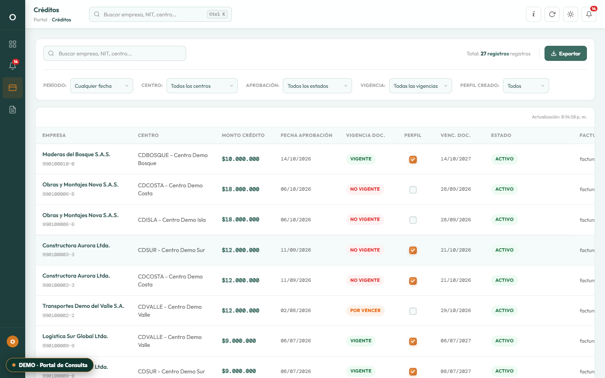<br>**Portal · Créditos** |
| 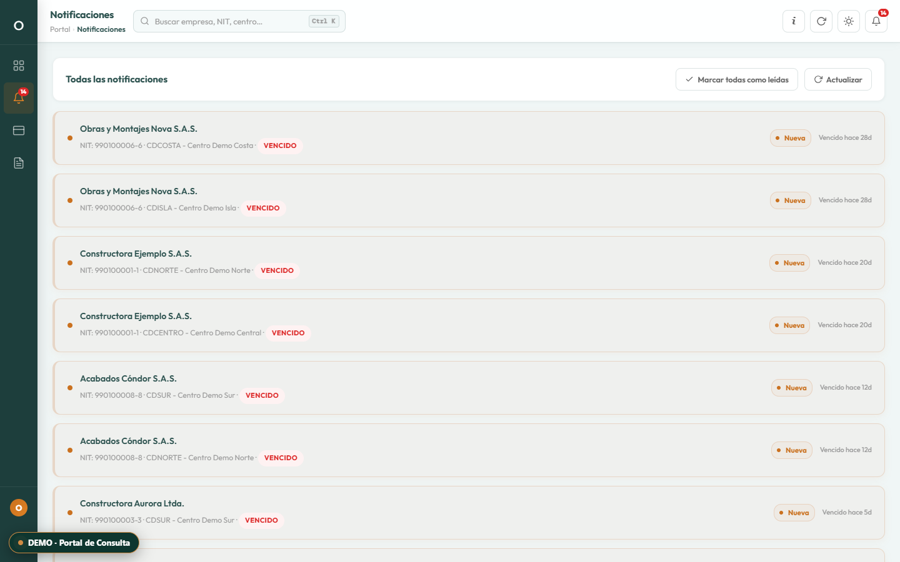<br>**Portal · Notificaciones** | 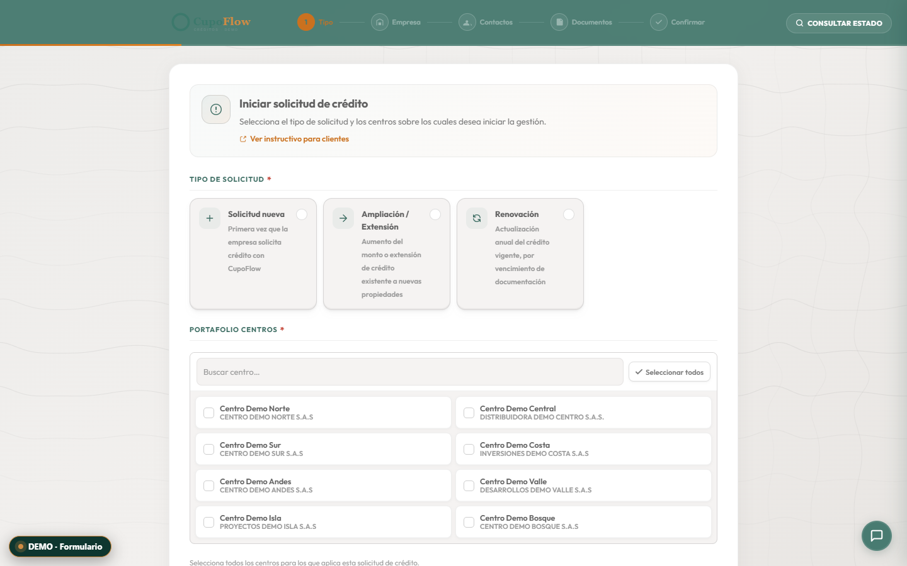<br>**Formulario · Paso 1** |

---

## Cómo funciona la demo

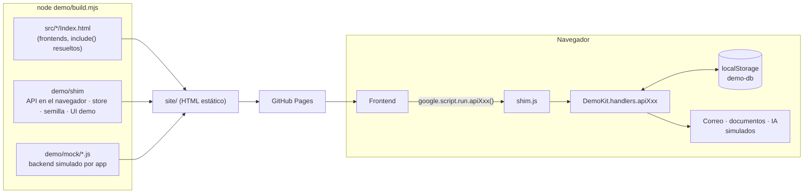

La lógica del frontend no se toca: `shim.js` implementa la interfaz de la API y despacha cada llamada a un *handler* que reproduce el contrato (argumentos y forma de la respuesta) de cada operación `api*`.

---

## Estructura del repositorio

```
.
├── src/                      # Frontends de las 4 apps (HTML, CSS y JS del cliente)
│   ├── indice/               #   Portal de acceso
│   ├── formulario/           #   Solicitud de crédito
│   ├── panel/                #   Panel de control
│   └── portal/               #   Portal de consulta
├── demo/
│   ├── build.mjs             # genera ./site a partir de src/ + shim + mocks
│   ├── shim/                 # API en el navegador, localStorage, semilla, UI de la demo, xlsx
│   └── mock/                 # backend simulado: indice / formulario / panel / portal
├── tools/
│   ├── e2e/                  # pruebas E2E con Playwright (todos los roles y flujos de escritura)
│   ├── scan-secrets.mjs      # escáner de secretos y datos personales
│   ├── screenshots.mjs       # capturas reales de la demo
│   ├── cover.mjs             # portada tipo mockup
│   └── serve.mjs             # servidor estático local
├── assets/                   # portada, capturas y logo de la demo
├── .github/workflows/pages.yml   # build + escaneo + despliegue en GitHub Pages
└── package.json
```

---

## Ejecutar la demo en local

```bash
npm install          # solo instala playwright-core (para pruebas y capturas)
npm run build        # genera ./site
npm run serve        # http://localhost:4173
npm test             # E2E de todas las apps (usa Chrome o Edge instalado)
npm run scan         # escaneo de secretos sobre todo el repo
```

> No necesitas dependencias para *construir* o servir la demo: `demo/build.mjs` solo usa Node 18 o superior.

---

## Transparencia

Este proyecto se desarrolló con asistencia de IA (Claude) en el código, los datos de ejemplo y la documentación. La revisión, las decisiones y las pruebas son mías.

---

<div align="center">

**Andrés Cabrales Baena** · Desarrollador de software · [andrescabralesbaena.com](https://andrescabralesbaena.com)

</div>
